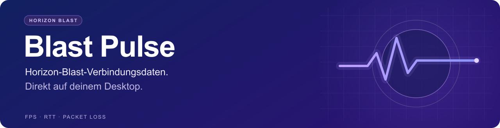
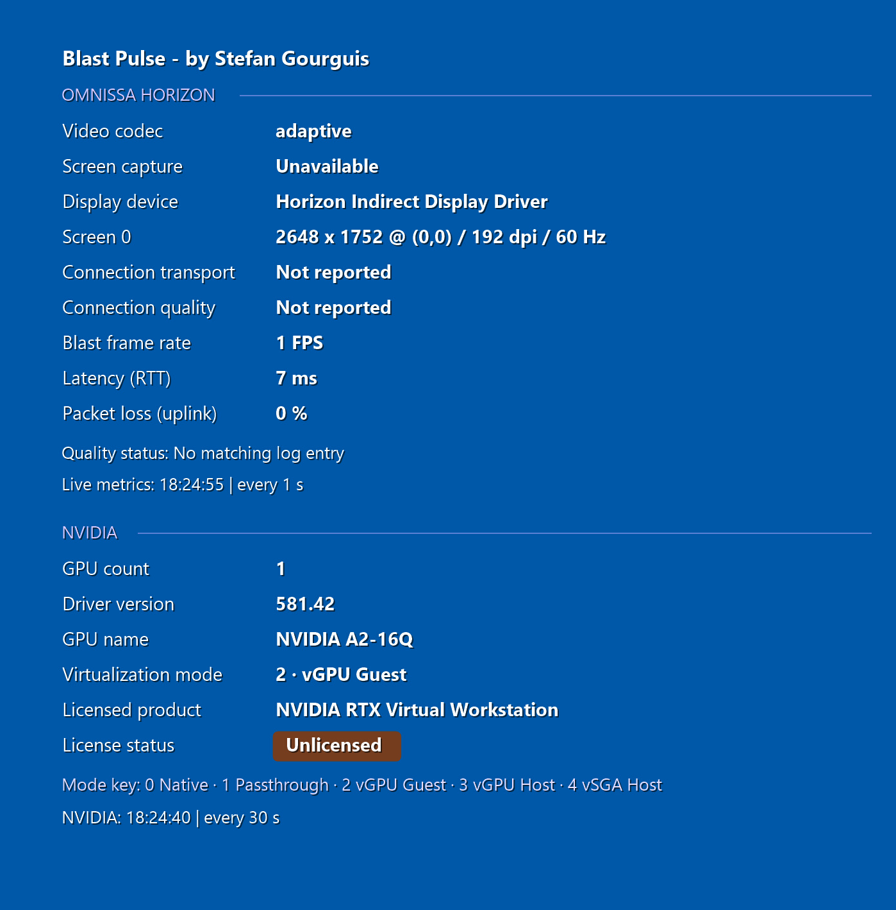
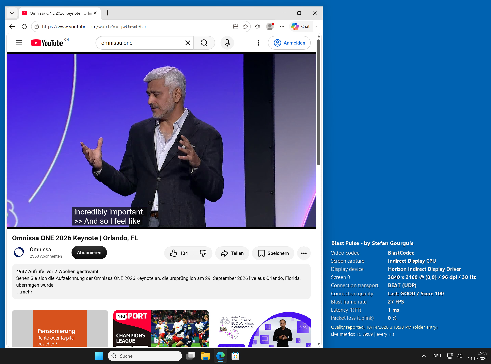

<div align="center">
<p></p>
<p>by <strong>Stefan Gourguis</strong> · Omnissa Tech Insider · solvig. GmbH · solvig.ch</p>
<p><kbd>Version 1.4.0</kbd> &nbsp; <kbd>Windows x64</kbd> &nbsp; <kbd>.NET Framework 4.8</kbd></p>
<p><a href="https://github.com/vmmachina/blastpulse/blob/main/README.md"><kbd>English</kbd></a> | <a href="https://github.com/vmmachina/blastpulse/blob/main/README.de.md"><kbd>Deutsch</kbd></a></p>
<p><a href="https://github.com/vmmachina/blastpulse/releases/download/v1.4.0/BlastPulse.exe"></a> &nbsp; <a href="https://github.com/vmmachina/blastpulse/releases/download/v1.4.0/BlastPulse-1.4.0-win-x64.zip"></a></p>
</div>

Die Idee entstand aus einer einfachen Unannehmlichkeit: Um die Verbindung zu prüfen, musste man immer wieder das ursprüngliche Horizon-Blast-Symbol unten rechts im Infobereich öffnen. Blast Pulse hält die relevanten Informationen direkt auf dem Desktop sichtbar, damit sich die Sitzung während der Arbeit beobachten lässt.

Die kompakte Anzeige zeigt Verbindungsdetails sowie Blast-FPS, Antwortzeit (RTT) und Uplink-Paketverlust. Live-Zähler werden standardmässig jede Sekunde aktualisiert. Die transparente Anzeige liegt unten rechts auf dem primären Desktop unter normalen Anwendungsfenstern. Das Hintergrundbild bleibt erhalten und wird nicht bei jeder Aktualisierung neu geschrieben.

## Aktueller Release — 1.4.0

- Zeigt Verbindungstransport und -qualität direkt aus dem unterstützten Horizon-Agent-Build, ohne das Horizon-Blast-Menü zu öffnen.
- Aktualisiert GOOD, OK und POOR gemäss Agent und zeigt den Abfragezeitpunkt.
- Ordnet Verbindungsinformationen der aktiven Sitzung und Verbindung zu; wenn ein direkter Wert fehlt, kann ein passender Logeintrag verwendet werden.

[Downloads und vollständige Release Notes](https://github.com/vmmachina/blastpulse/releases/latest)

## Im Einsatz

<p align="center"></p>

NVIDIA-GPU- und Lizenzangaben bei 192 DPI. Der Lizenzstatus stammt vom Gasttreiber.

<p align="center"></p>

Horizon-Sitzung während der Videowiedergabe. Messwerte und Log-Zeitstempel unterscheiden sich je nach Sitzung.

## Herunterladen und starten

[Blast Pulse 1.4.0 für Windows x64 (ZIP)](https://github.com/vmmachina/blastpulse/releases/download/v1.4.0/BlastPulse-1.4.0-win-x64.zip) herunterladen. Das Paket enthält die Anwendung, eine Beispielkonfiguration und die Release Notes.

Auf der [Release-Seite](https://github.com/vmmachina/blastpulse/releases/tag/v1.4.0) stehen auch die [einzelne EXE](https://github.com/vmmachina/blastpulse/releases/download/v1.4.0/BlastPulse.exe), [config.json](https://github.com/vmmachina/blastpulse/releases/download/v1.4.0/config.json) und [SHA-256-Prüfsummen](https://github.com/vmmachina/blastpulse/releases/download/v1.4.0/SHA256SUMS.txt) bereit.

Voraussetzungen sind Windows 10/11 x64, .NET Framework 4.8 und eine aktive Horizon-Blast-Sitzung mit lesbaren Sitzungszählern und Logs. Die Anwendung ist unsigniert.

1. ZIP in einen lokalen Ordner oder auf eine erreichbare Netzwerkfreigabe entpacken.
2. `BlastPulse.exe` innerhalb der Horizon-Blast-Sitzung starten.
3. Die Desktop-Anzeige erscheint und aktualisiert sich automatisch.

Ein Rechtsklick auf das BlastPulse-Symbol im Infobereich neben der Uhr öffnet **Language/Sprache → English / Deutsch**, **Desktop-Anzeige ausblenden/einblenden** und **Blast Pulse beenden**. Englisch ist die Standardsprache. Die Sprachwahl gilt sofort und wird für den jeweiligen Windows-Benutzer gespeichert.

## Anzeige anpassen

`config.json` neben `BlastPulse.exe` ablegen und Blast Pulse nach Änderungen neu starten. Ohne diese Datei gelten die folgenden Standardwerte.

| Einstellung | Standard | Zweck und zulässige Werte |
| --- | --- | --- |
| `RefreshSeconds` | `1` | Aktualisierung der Live-Zähler, 1–3600 Sekunden |
| `LogRefreshSeconds` | `5` | Aktualisierung der Log- und Bildschirmangaben, 1–3600 Sekunden |
| `PanelWidth` | `640` | Gewünschte Anzeigenbreite bei 96 DPI, 460–900 logische Pixel |
| `Margin` | `30` | Abstand zum rechten Rand bei 96 DPI, 12–150 logische Pixel |
| `BottomOffset` | `150` | Freiraum unter der Anzeige bei 96 DPI, 0–1000 logische Pixel |
| `FontSize` | `11` | Gewünschte Schriftgrösse, 10–22 Punkt |
| `FontFamily` | `"Segoe UI"` | Installierte Windows-Schrift; andernfalls verwendet Windows eine Ersatzschrift |
| `Language` | `"en"` | Anfängliche Sprache: `"en"` oder `"de"` |

Anzeigenbreite, Abstände und Schrift skalieren gemeinsam mit der aktuellen Windows-DPI-Einstellung. Die Pixelangaben oben beziehen sich auf 100 % Skalierung (96 DPI). Auflösungs- und DPI-Änderungen werden im laufenden Betrieb übernommen; nach Änderungen an `config.json` ist weiterhin ein Neustart nötig. Lange Beschriftungen, Werte und Fusszeilen werden umgebrochen. Die Anzeigenhöhe ergibt sich aus dem tatsächlichen Text. Reicht die Desktop-Fläche nicht aus, wird die Schrift nur so weit wie nötig verkleinert.

Der voreingestellte Abstand nach unten lässt Platz für vorhandenen BGInfo-Text. Für eine schmalere Anzeige direkt oberhalb der Taskleiste genügt diese vollständige `config.json`; ausgelassene Einstellungen behalten ihre Standardwerte:

```json
{
  "PanelWidth": 460,
  "Margin": 20,
  "BottomOffset": 0,
  "FontSize": 11
}
```

Die im Tray gewählte Sprache steht in `%LOCALAPPDATA%\BlastPulse\preferences.json` und hat Vorrang vor `Language` in der gemeinsamen Konfiguration. Um zur konfigurierten Sprache zurückzukehren, Blast Pulse beenden, diese Einstellungsdatei entfernen und die Anwendung erneut starten. Für `config.json` genügt Lesezugriff, auch auf einer Netzwerkfreigabe.

## Start von einer Freigabe oder per GPO

`BlastPulse.exe` und `config.json` gemeinsam auf der Freigabe ablegen. Benutzer benötigen Lesen/Ausführen. Für den Start bei der Anmeldung kann ein **Benutzer-Anmeldeskript** diesen Aufruf enthalten:

```bat
start "" "\\example.com\SYSVOL\example.com\scripts\BlastPulse\BlastPulse.exe"
```

Den Beispielpfad durch den eigenen UNC- oder lokalen Pfad ersetzen. Blast Pulse bleibt in der Benutzersitzung aktiv; das Anmeldeskript sollte deshalb nicht auf das Ende der Anwendung warten. Die Anwendung richtet selbst keinen Autostart ein. Bestehendes BGInfo kann parallel laufen; mit `BottomOffset` lässt sich genügend Platz dafür freihalten.

Eine feste Verzögerung im Anmeldeskript ist nicht nötig. Startet Explorer noch, prüft Blast Pulse ohne UI-Blockierung erneut, für maximal zwei Minuten pro Initialisierung. Danach enden die Timer-Versuche; neue Shell-/Sitzungsereignisse oder **Desktop-Anzeige einblenden** können eine neue Erkennung auslösen. Fehler und Wiederherstellung stehen in `%LOCALAPPDATA%\BlastPulse\desktop.log`.

Für ein Update Blast Pulse beenden, die EXE ersetzen und erneut starten. Die bestehende `config.json` beibehalten, damit die Positionierung erhalten bleibt. Vor einer breiteren Verteilung den Freigabezugriff und die Anwendungsrichtlinien der eigenen Organisation prüfen.

## Datenquellen

Blast Pulse liest die Daten lokal auf dem Windows-Desktop. Beim getesteten Agent-Build fragt es Transport und Qualität über die interne `wavedll.dll`-Schnittstelle des Agents ab. Diese ist keine dokumentierte öffentliche API und kann sich ändern. Bei anderen Builds werden verfügbare passende Logeinträge verwendet. Blast Pulse fragt keine Horizon-Connection-Server-API ab, benötigt keine Zugangsdaten und lädt die Werte nicht zu einem externen Dienst hoch.

| Angezeigte Information | Quelle |
| --- | --- |
| RTT und Uplink-Paketverlust | `Win32_PerfFormattedData_Counters_HorizonBlastSessionCounters`: `RTT`, `PacketLossUplink` |
| Blast-FPS | `Win32_PerfFormattedData_Counters_HorizonBlastImagingCounters`: `Framespersecond` |
| Codec-Name und Bildschirmaufnahme | Letzte passende Einträge `Created region encoder` und `Screen capture name` im Blast-Worker-Log der Sitzung |
| Verbindungstransport und -qualität | Direkte Agent-Abfrage beim unterstützten Build; sonst ein passender Sitzungslogeintrag, sofern vorhanden. Ein Log-Score erscheint nur mit dem zugehörigen Logstatus. |
| Display-Treiber, Auflösung und Bildwiederholrate | `Win32_VideoController`, gefiltert auf Geräte mit `Horizon` im Namen |
| Position und DPI des primären Bildschirms | Windows-Bildschirmkoordinaten und DPI der Desktop-Grafik |

Beide Leistungszählerklassen werden über WMI im Namensraum `root\cimv2` gelesen. Blast Pulse wählt die Zählerinstanz, deren `Name` mit `Session ID: <aktuelle Sitzungs-ID>;` beginnt.

Die kompakte Desktop-Anzeige stellt die sechs ursprünglichen Verbindungsangaben dar: Codec, Aufnahmeverfahren, Anzeigegerät, Bildschirmkonfiguration, Transport und Horizon-Qualität. Darunter stehen Blast-FPS, RTT und Uplink-Paketverlust. **Blast-FPS beschreiben die Desktop-Übertragung, nicht die Wiedergabe-Bildrate des Quellvideos.**

Die Logdatei liegt unter:

```text
%ProgramData%\Omnissa\Horizon\Logs\Blast-Worker-SessionId<Sitzungs-ID>.log
```

Für Codec, Aufnahme und Qualität werden höchstens die letzten 4 MiB gelesen. Diese Logwerte stammen aus dem jeweils letzten passenden Eintrag dieses Abschnitts und können älter als die aktuellen Leistungszähler sein. Der Codec-Name stammt direkt aus dem Log; eine Zuordnung numerischer Encoder-IDs wird nicht angenommen.

Transport und Qualität werden beim getesteten Agent-Build gemeinsam für die aktuelle Verbindung abgefragt. Die Anzeige zeigt den Abschlusszeitpunkt der Abfrage; der direkte Qualitätsstatus enthält keinen numerischen Score. Fehlt ein direkter Wert, kann eine passende Logbeobachtung mit eigenem Status, Score und Quellenzeitpunkt verwendet werden. Fehlende oder nicht bestätigte Informationen werden entsprechend gekennzeichnet.

Ein mehr als 90 Sekunden alter Logstatus wird als älterer Eintrag angezeigt. Der Transport wird nicht aus momentaner Datenverkehrsaktivität abgeleitet.

### Blast-Datagrammgrößen

Version 1.3.0 liest drei weitere Angaben aus dem Blast-Worker-Log der aktiven Sitzung:

| Anzeige | Logquelle |
| --- | --- |
| Blast-Datagrammmaximum | `BlastSocketBuildUDPResponse` — ausgehandeltes Maximum |
| Sicheres Datagramm TX | `BlastSocketUpdateSafeDatagramSendSize` — Agent → Client |
| Sicheres Datagramm RX | `BlastSocketUpdateSafeDatagramReceiveSize` — Client → Agent |

Das Log wird gemäß `LogRefreshSeconds` geprüft, standardmäßig alle fünf Sekunden. Jeder Wert behält seinen eigenen **letzten Logzeitpunkt**. Ein neuer passender Eintrag aktualisiert den betreffenden Wert; eine unveränderte Datei wird nicht als neue Messung dargestellt. Die Angaben sind protokollierte Blast-Datagrammgrößen, **keine Messung der IP- oder Pfad-MTU**.

Blast Pulse prüft Sitzung, PID und Startzeit des aktuellen `VMBlastW`-Workers gegen das Log und grenzt den Verbindungsabschnitt ab. Wird der direkte Zugriff auf die Startzeit verweigert, liest es `ProcessId`, `SessionId` und `CreationDate` über den lokalen WMI-Provider `Win32_Process`. Dazu werden keine Rechte erhöht oder Prozessberechtigungen geändert. Ohne eindeutigen Kontext erscheint **Nicht gemeldet**; die Fußzeile nennt den Grund.

Der inkrementelle Leser verarbeitet vollständig angehängte UTF-8-/UTF-16-Zeilen und erkennt Dateiaustausch, Kürzung und Historienlücken. Pro Abfrage werden höchstens 4 MiB und ein kleiner Dateikopf gelesen. Eine neue Verbindung oder ein neuer Worker braucht erneut geprüften Kontext; rotierte Archive werden nicht vermischt. Größenmeldungen enthalten keine Socket-ID und werden dem Worker-/Verbindungsabschnitt zugeordnet, nicht einzelnen parallelen Raw Channels. Aktualisierungen hängen davon ab, was der installierte Agent protokolliert.

Für einen einmaligen JSON-Export `BlastPulse.exe -datagram-json "C:\Pfad\datagram.json"` in der Horizon-Sitzung des Zielbenutzers aufrufen. Die Anwendung schreibt eine Momentaufnahme und beendet sich. Der Export enthält Rechner-/Sitzungskennungen, Worker- und Verbindungskontext, Status sowie die Quellenzeitpunkte der einzelnen Werte; diese Felder sollten ausgewertet werden. Fehlende Größen sind `null`. `DiscoveryMtuBytes` bleibt `null`; protokollierte Such-Standards beweisen keinen abgeschlossenen Suchlauf. Blast Pulse sendet keine MTU-Probes und ändert keine Netzwerkeinstellungen.

### NVIDIA-Daten

Der NVIDIA-Bereich liest die **NVML**-Bibliothek des installierten Treibers lokal aus. Er startet kein `nvidia-smi`, fragt den DLS-Server nicht ab und ändert keine Lizenzeinstellungen. Blast Pulse liefert keine NVIDIA-Bibliothek mit.

| NVIDIA-Information | NVML-Quelle |
| --- | --- |
| GPU-Anzahl | `nvmlDeviceGetCount_v2` — im Windows-Gast sichtbare Geräte |
| GPU-Name | `nvmlDeviceGetName` |
| Virtualisierungsmodus | `nvmlDeviceGetVirtualizationMode` |
| Treiberversion | `nvmlSystemGetDriverVersion` |
| Lizenzprodukt und Lizenzstatus | `nvmlDeviceGetGridLicensableFeatures_v4` — Produktname, Aktivierungskennzeichen und Lizenzstatus |

Ein unterstütztes, aktiviertes Feature erscheint entsprechend der Treibermeldung als **Lizenziert** oder **Nicht lizenziert**. Deaktivierte Features und nicht unterstützte Lizenzierung werden gesondert ausgewiesen. Ist eine Abfrage nicht verfügbar oder der Datenstand älter als 90 Sekunden, erscheint **Unbekannt**. Die Abfrage läuft in einem eigenen Prozess mit zehn Sekunden Zeitlimit, damit ein hängender Treiberaufruf die Blast-Messungen nicht aufhält.

**Lizenziert** beschreibt den vom Gasttreiber gemeldeten Zustand. Das belegt für sich allein keine aktuelle Verbindung zu NVIDIA DLS. Blast Pulse liest keine Lizenz-Token-Dateien und ruft keine APIs für UUIDs, Seriennummern oder Lizenzserver-Verwaltung auf. Token, GPU-UUIDs, Seriennummern und Serveradressen erscheinen nicht in der Anzeige.

## Kompatibilität

Blast Pulse 1.4.0 für Windows x64.

Der Windows-Build und die automatisierten Regressionen für 1.4 bestanden. In einer Horizon-VDI bestätigte der vorherige funktionsgleiche Testbuild BEAT (UDP), den Wechsel von GOOD zu OK, die englische und deutsche Anzeige sowie das Wiederverbinden mit demselben Worker. Die endgültige 1.4-EXE selbst wurde dort noch nicht getestet. Andere Agent-Builds, ein Workerwechsel, TCP-/POOR-Wechsel und Mehrbenutzerbetrieb bleiben live ungeprüft.

Die NVIDIA-Anzeige wurde in einer Horizon-vGPU-Sitzung mit NVIDIA A2-16Q, Treiber 581.42 und 192 DPI geprüft. Alle sechs NVIDIA-Werte waren sichtbar; der Treiber meldete **Nicht lizenziert**. Andere Lizenzzustände und mehrere GPUs wurden noch nicht an echter Hardware geprüft. Die automatischen Windows-Regressionsprüfungen für den Quellstand von 1.2 waren erfolgreich, einschliesslich Lizenzstatus, Abfrage-Zeitlimit, englischer/deutscher Anzeige und DPI-Layouts.

Die Basisversion 1.1 bestand die automatischen Windows-Darstellungsprüfungen bei 100, 125, 150, 200 und 300 % Skalierung erfolgreich, auch mit grosser Schrift und schmalen Anzeigen. Der Nutzertest unter Horizon bestätigte vollständig lesbare Anzeigen bei 3840 × 2160 mit 192 DPI (200 %) und 1920 × 1080 mit 168 DPI (175 %).

- Die Anzeige nutzt den primären Bildschirm. Mehrere Monitore, Explorer-Neustarts und Sitzungswiederverbindungen wurden noch nicht umfassend getestet.
- Welche Angaben verfügbar sind, hängt von Horizon-Agent-Version, Logformat und den Zugriffsrechten auf Zähler und Logs ab.
- Eine zentrale Verteilung vor dem Rollout in der eigenen Umgebung testen.

## Herstellerreferenzen

- [Omnissa: Blast-Leistungszähler](https://docs.omnissa.com/de-DE/Horizon-Remote-Desktop-Features-V2606/ExaminingBlastSessionStatisticswithWindowsPerformanceMonitor)
- [Omnissa: Blast-Logs und Paketverlust](https://kb.omnissa.com/s/article/89455)

- [NVIDIA: NVML-vGPU-Abfragen](https://docs.nvidia.com/deploy/nvml-api/latest/api/group__nvmlVirtualGpuQueries.html)
- [NVIDIA: vGPU-Lizenzierung und Fehlersuche](https://docs.nvidia.com/vgpu/latest/grid-licensing-user-guide/troubleshooting-grid-licensing.html)
