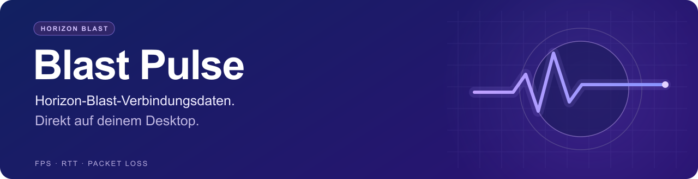
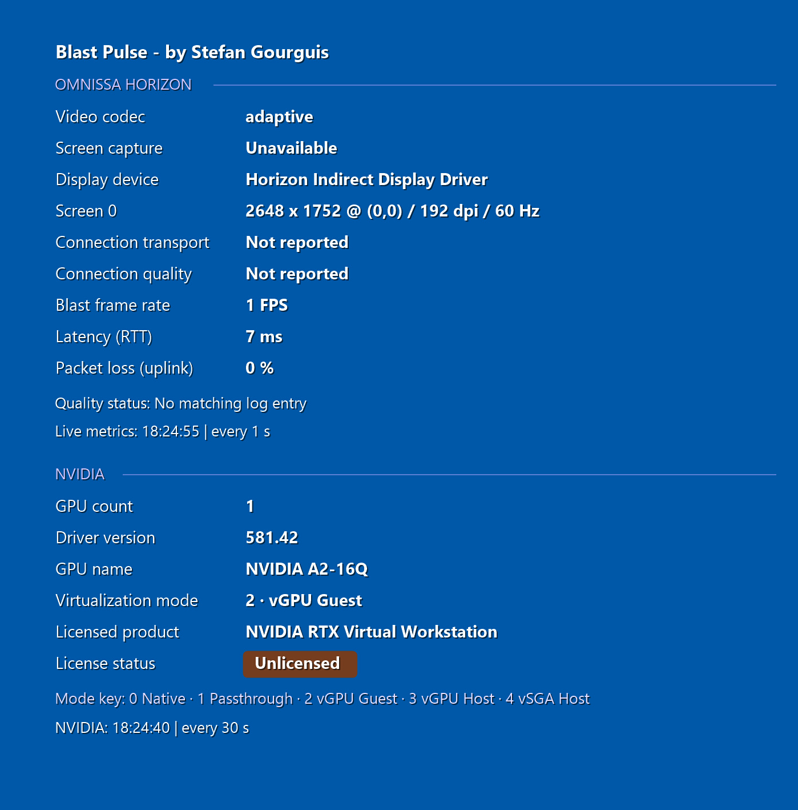

<div align="center">
<p></p>
<p>by <strong>Stefan Gourguis</strong> · Omnissa Tech Insider · solvig. GmbH · solvig.ch</p>
<p><kbd>Version 1.2</kbd> &nbsp; <kbd>Windows x64</kbd> &nbsp; <kbd>.NET Framework 4.8</kbd></p>
<p><a href="https://github.com/vmmachina/blastpulse/blob/main/README.md"><kbd>English</kbd></a> | <a href="https://github.com/vmmachina/blastpulse/blob/main/README.de.md"><kbd>Deutsch</kbd></a></p>
<p><a href="https://github.com/vmmachina/blastpulse/releases/download/v1.2.0/BlastPulse.exe"></a> &nbsp; <a href="https://github.com/vmmachina/blastpulse/releases/download/v1.2.0/BlastPulse-1.2.0-win-x64.zip"></a></p>
</div>

Die Idee entstand aus einer einfachen Unannehmlichkeit: Um die Verbindung zu prüfen, musste man immer wieder das ursprüngliche Horizon-Blast-Symbol unten rechts im Infobereich öffnen. Blast Pulse hält die relevanten Informationen direkt auf dem Desktop sichtbar, damit sich die Sitzung während der Arbeit beobachten lässt.

Die kompakte Anzeige zeigt Verbindungsdetails sowie Blast-FPS, Antwortzeit (RTT) und Uplink-Paketverlust. Live-Zähler werden standardmässig jede Sekunde aktualisiert. Die transparente Anzeige liegt unten rechts auf dem primären Desktop unter normalen Anwendungsfenstern. Das Hintergrundbild bleibt erhalten und wird nicht bei jeder Aktualisierung neu geschrieben.

## Aktueller Release — 1.2

- NVIDIA-GPU-Anzahl, GPU-Name, Virtualisierungsmodus, Treiberversion, Lizenzprodukt und Lizenzstatus.
- Getrennte Horizon-/NVIDIA-Bereiche mit violetten Trennlinien und farbigen Lizenz-Badges.
- NVIDIA-Abfrage alle 30 Sekunden, unabhängig von den Blast-Livezählern.

[Downloads und vollständige Release Notes](https://github.com/vmmachina/blastpulse/releases/latest)

## Im Einsatz

<p align="center"></p>

NVIDIA-GPU- und Lizenzangaben bei 192 DPI. Der Lizenzstatus stammt vom Gasttreiber.

<p align="center"></p>

Horizon-Sitzung während der Videowiedergabe. Messwerte und Log-Zeitstempel unterscheiden sich je nach Sitzung.

## Herunterladen und starten

[Blast Pulse 1.2 für Windows x64 (ZIP)](https://github.com/vmmachina/blastpulse/releases/download/v1.2.0/BlastPulse-1.2.0-win-x64.zip) herunterladen. Das Paket enthält die Anwendung, eine Beispielkonfiguration und die Dokumentation auf Englisch und Deutsch. Zum Offline-Lesen das ZIP entpacken und `README.html` im Browser öffnen; die Links English/Deutsch oben wechseln die Sprache.

Auf der [Release-Seite](https://github.com/vmmachina/blastpulse/releases/tag/v1.2.0) stehen auch die [einzelne EXE](https://github.com/vmmachina/blastpulse/releases/download/v1.2.0/BlastPulse.exe), [config.json](https://github.com/vmmachina/blastpulse/releases/download/v1.2.0/config.json) und [SHA-256-Prüfsummen](https://github.com/vmmachina/blastpulse/releases/download/v1.2.0/SHA256SUMS.txt) bereit.

Voraussetzungen sind Windows 10/11 x64, .NET Framework 4.8 und eine aktive Horizon-Blast-Sitzung mit lesbaren Sitzungszählern und Logs. Die Anwendung ist unsigniert.

1. ZIP in einen lokalen Ordner oder auf eine erreichbare Netzwerkfreigabe entpacken.
2. `BlastPulse.exe` innerhalb der Horizon-Blast-Sitzung starten.
3. Die Desktop-Anzeige erscheint und aktualisiert sich automatisch.

Ein Rechtsklick auf das BlastPulse-Symbol im Infobereich neben der Uhr öffnet **Language/Sprache → English / Deutsch**, **Desktop-Anzeige ausblenden/einblenden** und **Blast Pulse beenden**. Englisch ist die Standardsprache. Die Sprachwahl gilt sofort und wird für den jeweiligen Windows-Benutzer gespeichert.

## Anzeige anpassen

`config.json` neben `BlastPulse.exe` ablegen und Blast Pulse nach Änderungen neu starten. Ohne diese Datei gelten die folgenden Standardwerte.

| Einstellung | Standard | Zweck und zulässige Werte |
| --- | --- | --- |
| `RefreshSeconds` | `1` | Aktualisierung der Live-Zähler, 1–3600 Sekunden |
| `LogRefreshSeconds` | `5` | Aktualisierung der Log- und Bildschirmangaben, 1–3600 Sekunden |
| `PanelWidth` | `640` | Gewünschte Anzeigenbreite bei 96 DPI, 460–900 logische Pixel |
| `Margin` | `30` | Abstand zum rechten Rand bei 96 DPI, 12–150 logische Pixel |
| `BottomOffset` | `150` | Freiraum unter der Anzeige bei 96 DPI, 0–1000 logische Pixel |
| `FontSize` | `11` | Gewünschte Schriftgrösse, 10–22 Punkt |
| `FontFamily` | `"Segoe UI"` | Installierte Windows-Schrift; andernfalls verwendet Windows eine Ersatzschrift |
| `Language` | `"en"` | Anfängliche Sprache: `"en"` oder `"de"` |

Anzeigenbreite, Abstände und Schrift skalieren gemeinsam mit der aktuellen Windows-DPI-Einstellung. Die Pixelangaben oben beziehen sich auf 100 % Skalierung (96 DPI). Auflösungs- und DPI-Änderungen werden im laufenden Betrieb übernommen; nach Änderungen an `config.json` ist weiterhin ein Neustart nötig. Lange Beschriftungen, Werte und Fusszeilen werden umgebrochen. Die Anzeigenhöhe ergibt sich aus dem tatsächlichen Text. Reicht die Desktop-Fläche nicht aus, wird die Schrift nur so weit wie nötig verkleinert.

Der voreingestellte Abstand nach unten lässt Platz für vorhandenen BGInfo-Text. Für eine schmalere Anzeige direkt oberhalb der Taskleiste genügt diese vollständige `config.json`; ausgelassene Einstellungen behalten ihre Standardwerte:

```json
{
  "PanelWidth": 460,
  "Margin": 20,
  "BottomOffset": 0,
  "FontSize": 11
}
```

Die im Tray gewählte Sprache steht in `%LOCALAPPDATA%\BlastPulse\preferences.json` und hat Vorrang vor `Language` in der gemeinsamen Konfiguration. Um zur konfigurierten Sprache zurückzukehren, Blast Pulse beenden, diese Einstellungsdatei entfernen und die Anwendung erneut starten. Für `config.json` genügt Lesezugriff, auch auf einer Netzwerkfreigabe.

## Start von einer Freigabe oder per GPO

`BlastPulse.exe` und `config.json` gemeinsam auf der Freigabe ablegen. Benutzer benötigen Lesen/Ausführen. Für den Start bei der Anmeldung kann ein **Benutzer-Anmeldeskript** diesen Aufruf enthalten:

```bat
start "" "\\example.com\SYSVOL\example.com\scripts\BlastPulse\BlastPulse.exe"
```

Den Beispielpfad durch den eigenen UNC- oder lokalen Pfad ersetzen. Blast Pulse bleibt in der Benutzersitzung aktiv; das Anmeldeskript sollte deshalb nicht auf das Ende der Anwendung warten. Die Anwendung richtet selbst keinen Autostart ein. Bestehendes BGInfo kann parallel laufen; mit `BottomOffset` lässt sich genügend Platz dafür freihalten.

Für ein Update Blast Pulse beenden, die EXE ersetzen und erneut starten. Die bestehende `config.json` beibehalten, damit die Positionierung erhalten bleibt. Vor einer breiteren Verteilung den Freigabezugriff und die Anwendungsrichtlinien der eigenen Organisation prüfen.

## Datenquellen

Blast Pulse liest die Daten lokal auf dem Windows-Desktop. Es fragt keine Horizon-Connection-Server-API ab und ruft die interne `wavedll.dll`-Schnittstelle des Tray-Tools nicht auf. Blast Pulse benötigt keine Zugangsdaten und lädt die ausgelesenen Werte nicht zu einem externen Dienst hoch.

| Angezeigte Information | Quelle |
| --- | --- |
| RTT und Uplink-Paketverlust | `Win32_PerfFormattedData_Counters_HorizonBlastSessionCounters`: `RTT`, `PacketLossUplink` |
| Blast-FPS | `Win32_PerfFormattedData_Counters_HorizonBlastImagingCounters`: `Framespersecond` |
| Codec-Name und Bildschirmaufnahme | Letzte passende Einträge `Created region encoder` und `Screen capture name` im Blast-Worker-Log der Sitzung |
| Horizon-Qualitätsstatus, Score und Transport-Backend | Letzter Eintrag `BlastSocket_GetVvcQualityIndicators`: `qualityState`, `qualityScore`, `Backend` und der Zeitstempel des Eintrags |
| Display-Treiber, Auflösung und Bildwiederholrate | `Win32_VideoController`, gefiltert auf Geräte mit `Horizon` im Namen |
| Position und DPI des primären Bildschirms | Windows-Bildschirmkoordinaten und DPI der Desktop-Grafik |

Beide Leistungszählerklassen werden über WMI im Namensraum `root\cimv2` gelesen. Blast Pulse wählt die Zählerinstanz, deren `Name` mit `Session ID: <aktuelle Sitzungs-ID>;` beginnt.

Die kompakte Desktop-Anzeige stellt die sechs ursprünglichen Verbindungsangaben dar: Codec, Aufnahmeverfahren, Anzeigegerät, Bildschirmkonfiguration, Transport und Horizon-Qualität. Darunter stehen Blast-FPS, RTT und Uplink-Paketverlust. **Blast-FPS beschreiben die Desktop-Übertragung, nicht die Wiedergabe-Bildrate des Quellvideos.**

Die Logdatei liegt unter:

```text
%ProgramData%\Omnissa\Horizon\Logs\Blast-Worker-SessionId<Sitzungs-ID>.log
```

Gelesen werden höchstens die letzten 4 MiB. Logwerte stammen aus dem jeweils letzten passenden Eintrag dieses Abschnitts und können älter als die aktuellen Leistungszähler sein. Der Codec-Name stammt direkt aus dem Log; eine Zuordnung numerischer Encoder-IDs wird nicht angenommen.

Der originale Qualitätsstatus hat einen eigenen Zeitstempel. Er hängt von einem passenden Agent-Logeintrag ab; Blast Pulse fordert keine Aktualisierung beim ursprünglichen Tray-Tool an. Eine kontinuierliche Aktualisierung des Originalstatus ist nicht garantiert. Ein mehr als 90 Sekunden alter Originalstatus wird als älterer Logstand gekennzeichnet. Blast Pulse gibt keine selbst berechnete Bewertung als Horizon-Status aus.

Fehlt im aktuellen Logabschnitt ein passender Qualitäts-Eintrag, zeigen Transport und Qualität **Nicht gemeldet**. Die Fußzeile lautet **Qualitätsstatus: Kein passender Logeintrag**. Das betrifft diesen einzelnen Eintrag; Codec-/Aufnahmeangaben aus dem Log und Live-Zähler können trotzdem verfügbar sein. Bei erkanntem Eintrag steht dessen eigene Meldezeit; ein nicht erkannter Zeitstempel wird gesondert ausgewiesen.

Der angezeigte Verbindungstransport stammt aus dem Log. Er wird nicht aus der momentanen Datenverkehrsaktivität abgeleitet.

### NVIDIA-Daten

Der NVIDIA-Bereich liest die **NVML**-Bibliothek des installierten Treibers lokal aus. Er startet kein `nvidia-smi`, fragt den DLS-Server nicht ab und ändert keine Lizenzeinstellungen. Blast Pulse liefert keine NVIDIA-Bibliothek mit.

| NVIDIA-Information | NVML-Quelle |
| --- | --- |
| GPU-Anzahl | `nvmlDeviceGetCount_v2` — im Windows-Gast sichtbare Geräte |
| GPU-Name | `nvmlDeviceGetName` |
| Virtualisierungsmodus | `nvmlDeviceGetVirtualizationMode` |
| Treiberversion | `nvmlSystemGetDriverVersion` |
| Lizenzprodukt und Lizenzstatus | `nvmlDeviceGetGridLicensableFeatures_v4` — Produktname, Aktivierungskennzeichen und Lizenzstatus |

Ein unterstütztes, aktiviertes Feature erscheint entsprechend der Treibermeldung als **Lizenziert** oder **Nicht lizenziert**. Deaktivierte Features und nicht unterstützte Lizenzierung werden gesondert ausgewiesen. Ist eine Abfrage nicht verfügbar oder der Datenstand älter als 90 Sekunden, erscheint **Unbekannt**. Die Abfrage läuft in einem eigenen Prozess mit zehn Sekunden Zeitlimit, damit ein hängender Treiberaufruf die Blast-Messungen nicht aufhält.

**Lizenziert** beschreibt den vom Gasttreiber gemeldeten Zustand. Das belegt für sich allein keine aktuelle Verbindung zu NVIDIA DLS. Blast Pulse liest keine Lizenz-Token-Dateien und ruft keine APIs für UUIDs, Seriennummern oder Lizenzserver-Verwaltung auf. Token, GPU-UUIDs, Seriennummern und Serveradressen erscheinen nicht in der Anzeige.

## Kompatibilität

Blast Pulse 1.2 für Windows x64.

Die NVIDIA-Anzeige wurde in einer Horizon-vGPU-Sitzung mit NVIDIA A2-16Q, Treiber 581.42 und 192 DPI geprüft. Alle sechs NVIDIA-Werte waren sichtbar; der Treiber meldete **Nicht lizenziert**. Andere Lizenzzustände und mehrere GPUs wurden noch nicht an echter Hardware geprüft. Der automatische Windows-Regressionslauf für 1.2 steht noch aus.

Die Basisversion 1.1 bestand die automatischen Windows-Darstellungsprüfungen bei 100, 125, 150, 200 und 300 % Skalierung erfolgreich, auch mit grosser Schrift und schmalen Anzeigen. Der Nutzertest unter Horizon bestätigte vollständig lesbare Anzeigen bei 3840 × 2160 mit 192 DPI (200 %) und 1920 × 1080 mit 168 DPI (175 %).

- Die Anzeige nutzt den primären Bildschirm. Mehrere Monitore, Explorer-Neustarts und Sitzungswiederverbindungen wurden noch nicht umfassend getestet.
- Welche Angaben verfügbar sind, hängt von Horizon-Agent-Version, Logformat und den Zugriffsrechten auf Zähler und Logs ab.
- Eine zentrale Verteilung vor dem Rollout in der eigenen Umgebung testen.

## Herstellerreferenzen

- [Omnissa: Blast-Leistungszähler](https://docs.omnissa.com/de-DE/Horizon-Remote-Desktop-Features-V2606/ExaminingBlastSessionStatisticswithWindowsPerformanceMonitor)
- [Omnissa: Blast-Logs und Paketverlust](https://kb.omnissa.com/s/article/89455)

- [NVIDIA: NVML-vGPU-Abfragen](https://docs.nvidia.com/deploy/nvml-api/latest/api/group__nvmlVirtualGpuQueries.html)
- [NVIDIA: vGPU-Lizenzierung und Fehlersuche](https://docs.nvidia.com/vgpu/latest/grid-licensing-user-guide/troubleshooting-grid-licensing.html)
