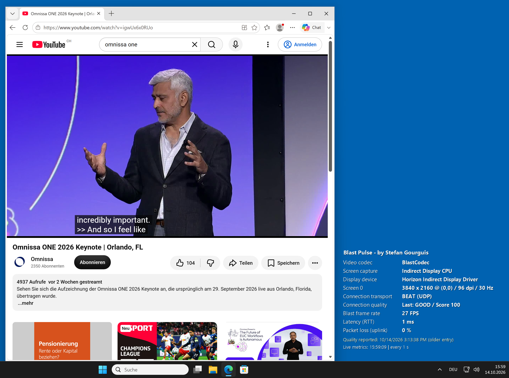
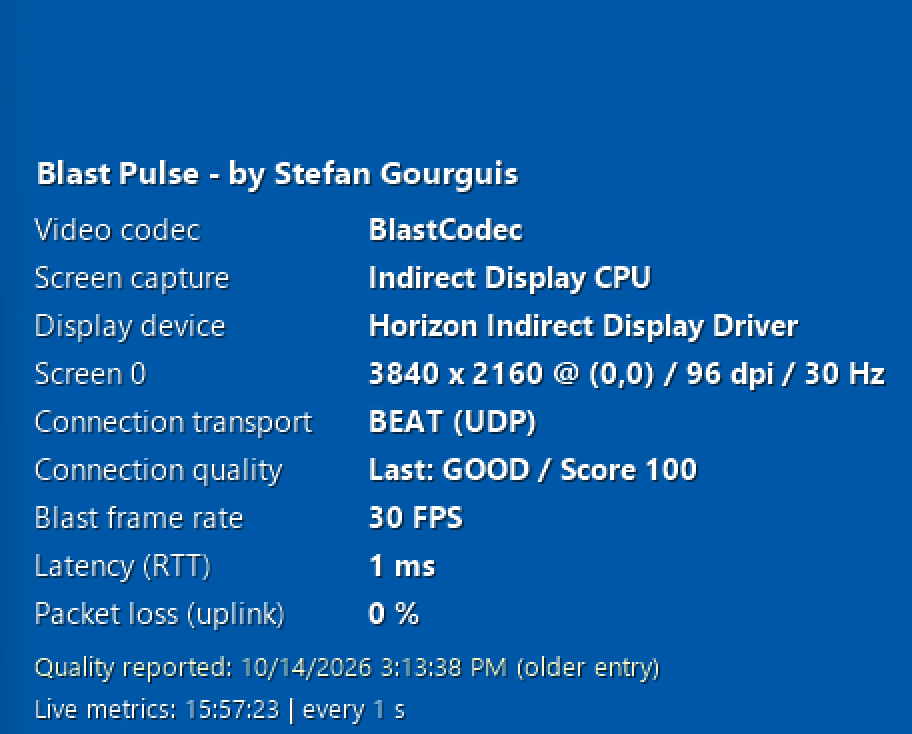

<div align="center">
<p></p>
<p>by <strong>Stefan Gourguis</strong> · Omnissa Tech Insider · solvig. GmbH · solvig.ch</p>
<p><kbd>Version 1.0</kbd> &nbsp; <kbd>Windows x64</kbd> &nbsp; <kbd>.NET Framework 4.x</kbd></p>
<p><a href="https://github.com/vmmachina/blastpulse/blob/main/README.md"><kbd>English</kbd></a> | <a href="https://github.com/vmmachina/blastpulse/blob/main/README.de.md"><kbd>Deutsch</kbd></a></p>
<p><a href="https://github.com/vmmachina/blastpulse/releases/download/v1.0.0/BlastPulse.exe"></a> &nbsp; <a href="https://github.com/vmmachina/blastpulse/releases/download/v1.0.0/BlastPulse-1.0.0-win-x64.zip"></a></p>
</div>

The idea came from a simple inconvenience: checking a connection meant repeatedly opening the original Horizon Blast tray icon at the bottom right of the screen. Blast Pulse keeps the relevant information visible on the desktop, so you can follow your session while you work.

The compact display shows connection details alongside Blast FPS, round-trip time (RTT) and uplink packet loss. Live counters refresh every second by default. It appears as a transparent layer at the bottom right of the primary desktop, beneath ordinary application windows. Your wallpaper remains the background; it is not rewritten for each update.

## In action

<p align="center"></p>

Example session during video playback. Metrics and log timestamps vary by session.

<details>
<summary>Connection details — close-up</summary>

<p align="center"></p>

</details>

## Download and start

Download [Blast Pulse 1.0 for Windows x64 (ZIP)](https://github.com/vmmachina/blastpulse/releases/download/v1.0.0/BlastPulse-1.0.0-win-x64.zip). The package contains the application, an example configuration and English/German documentation. For offline reading, extract the ZIP and open `README.html` in your browser; use the English/Deutsch links at the top to change language.

The [release page](https://github.com/vmmachina/blastpulse/releases/tag/v1.0.0) also offers the [standalone EXE](https://github.com/vmmachina/blastpulse/releases/download/v1.0.0/BlastPulse.exe), [config.json](https://github.com/vmmachina/blastpulse/releases/download/v1.0.0/config.json) and [SHA-256 checksums](https://github.com/vmmachina/blastpulse/releases/download/v1.0.0/SHA256SUMS.txt).

You need Windows 10/11 x64, .NET Framework 4.x and an active Horizon Blast session with readable session counters and logs. The application is unsigned.

1. Extract the ZIP into a local folder or an accessible network share.
2. Run `BlastPulse.exe` inside your Horizon Blast session.
3. The desktop display appears and updates automatically.

Right-click the Blast Pulse icon in the notification area next to the clock to change **Language → English / Deutsch**, **Hide/Show desktop display**, or **Exit Blast Pulse**. English is the default. A language change takes effect immediately and is remembered for your Windows user.

## Adjust the display

Place `config.json` beside `BlastPulse.exe` and restart Blast Pulse after editing it. Without this file, the defaults below apply.

| Setting | Default | Purpose and allowed values |
| --- | --- | --- |
| `RefreshSeconds` | `1` | Live counter refresh interval, 1–3600 seconds |
| `LogRefreshSeconds` | `5` | Log and display-information refresh interval, 1–3600 seconds |
| `PanelWidth` | `640` | Display width, 460–900 pixels |
| `Margin` | `30` | Distance from the right edge, 12–150 pixels |
| `BottomOffset` | `150` | Space below the display within the desktop working area, 0–1000 pixels |
| `FontSize` | `11` | Text size, 10–22 points |
| `FontFamily` | `"Segoe UI"` | Installed Windows font; Windows substitutes a font if unavailable |
| `Language` | `"en"` | Initial language: `"en"` or `"de"` |

The default bottom offset leaves room for existing BGInfo text. For a narrower display directly above the taskbar, use this complete `config.json`; omitted settings retain their defaults:

```json
{
  "PanelWidth": 460,
  "Margin": 20,
  "BottomOffset": 0,
  "FontSize": 11
}
```

The language selected in the tray is saved in `%LOCALAPPDATA%\BlastPulse\preferences.json` and takes priority over `Language` in the shared configuration. To return to the configured language, exit Blast Pulse, remove that preference file and start it again. Users only need read access to `config.json`, including when it is on a network share.

## Start from a share or GPO

Keep `BlastPulse.exe` and `config.json` together on the share. Users need read/execute access. To start it at sign-in, add a command like this to a **user logon script**:

```bat
start "" "\\example.com\SYSVOL\example.com\scripts\BlastPulse\BlastPulse.exe"
```

Replace the example path with your own UNC or local path. Blast Pulse keeps running in the user's session, so the logon script should not wait for it to exit. The application does not set up autostart itself. Existing BGInfo can run alongside it; adjust `BottomOffset` to leave enough space.

For an update, exit Blast Pulse, replace the EXE and start it again. Keep your existing `config.json` to preserve your layout. Test share access and your organisation's application policies before wider deployment.

## Data sources

Blast Pulse reads data locally on the Windows desktop. It does not query a Horizon Connection Server API or call the tray tool's internal `wavedll.dll` interface. No credentials are required by Blast Pulse, and it does not upload the collected values to an external service.

| Desktop information | Source |
| --- | --- |
| RTT and uplink packet loss | `Win32_PerfFormattedData_Counters_HorizonBlastSessionCounters`: `RTT`, `PacketLossUplink` |
| Blast FPS | `Win32_PerfFormattedData_Counters_HorizonBlastImagingCounters`: `Framespersecond` |
| Codec name and screen capture method | Latest matching `Created region encoder` and `Screen capture name` entries in the session's Blast-Worker log |
| Horizon quality state, score and transport backend | Latest `BlastSocket_GetVvcQualityIndicators` entry: `qualityState`, `qualityScore`, `Backend` and the entry's timestamp |
| Display driver, resolution and refresh rate | `Win32_VideoController`, filtered to devices whose name contains `Horizon` |
| Primary screen position and DPI | Windows screen bounds and desktop graphics DPI |

Both performance-counter classes are read through WMI in `root\cimv2`. Blast Pulse selects the counter instance whose `Name` starts with `Session ID: <current session ID>;`.

The compact desktop view prioritizes the six original connection details: codec, capture method, display device, screen configuration, transport and Horizon quality. Blast FPS, RTT and uplink packet loss appear beneath them. **Blast FPS describes the desktop transmission, not the source video's playback frame rate.**

The log file is:

```text
%ProgramData%\Omnissa\Horizon\Logs\Blast-Worker-SessionId<session ID>.log
```

Only the last 4 MiB are read. Log values represent the latest matching entry in that section and may be older than the current counter readings. The codec name comes directly from the log; no numeric encoder-to-codec mapping is assumed.

**The original Horizon quality status is not guaranteed to update continuously.** It depends on a matching Agent log entry; Blast Pulse does not request an update from the original tray tool. Blast Pulse shows that entry's own timestamp and marks a status older than 90 seconds as an older log state. It does not present a custom rating as Horizon's original status.

If the current log section contains no matching quality entry, transport and quality show **Not reported**. The footer says **Quality status: No matching log entry**. This refers specifically to the quality entry; codec/capture log data and live counters can still be available. A recognized entry displays its own report time; an unrecognized timestamp is identified separately.

The displayed connection transport is the backend recorded in the log. It is not inferred from momentary traffic activity.

## Compatibility

Blast Pulse 1.0 for Windows x64.

- The display uses the primary screen. Multiple monitors, display/DPI changes, Explorer restarts and session reconnects have not been comprehensively tested.
- Available information depends on the Horizon Agent version, log format and the user's access to the counters and logs.
- Test central deployment in your own environment before rollout.

## References

- [Omnissa: Blast performance counters](https://docs.omnissa.com/de-DE/Horizon-Remote-Desktop-Features-V2606/ExaminingBlastSessionStatisticswithWindowsPerformanceMonitor)
- [Omnissa: Blast logs and packet loss](https://kb.omnissa.com/s/article/89455)
